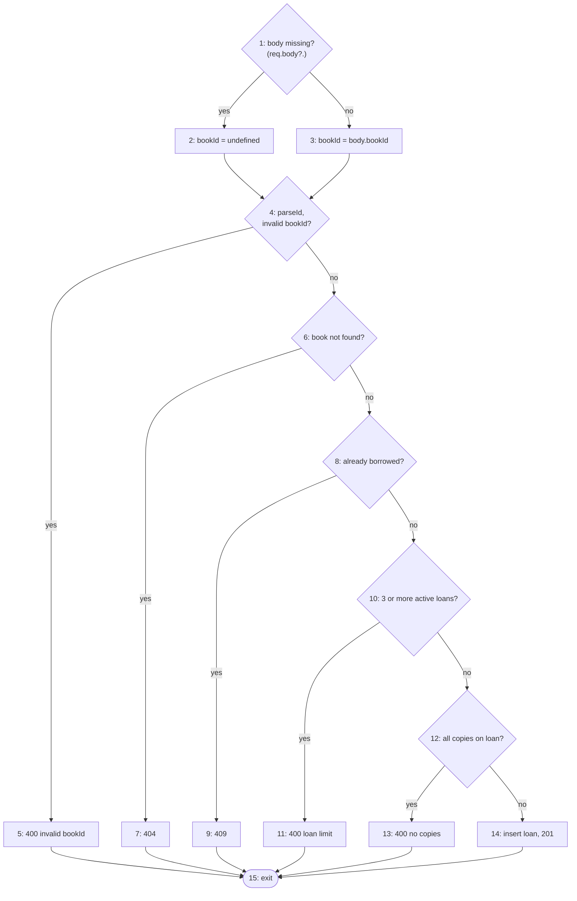
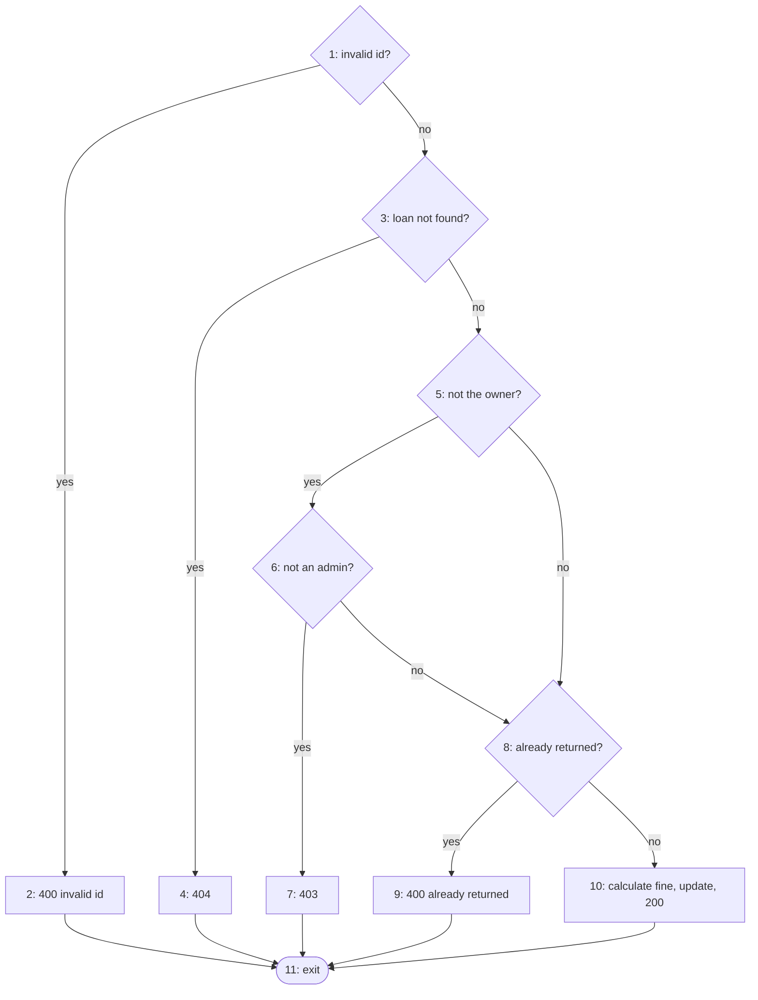

# 4. White-Box Testing

## 4.1 Approach

Test cases are designed here **from the source code**: the control flow is drawn, cyclomatic complexity is calculated, and tests are written to cover every statement and every branch.

| Item | Details |
|---|---|
| Core modules under test | `routes/loans.js` and `utils/loanRules.js` (borrow, return, fines; high-risk features F-05 and F-06) |
| | `utils/validation.js` (contains the most complex function in the backend) |
| Also covered | Branches in `app.js`, `db.js` and `routes/auth.js` that no other suite reached (section 4.6) |
| Tools | Jest 30 coverage (Istanbul), ESLint 9 `complexity` rule to check the manual calculations |
| Tests | 61 tests in `backend/tests/whitebox/` |
| Executed on | 2026-11-24, Windows 11, Node.js 24.11 |

### How to run

```bash
cd backend
npm install
npm run test:whitebox            # all 61 tests, with coverage
npm run test:whitebox:statement  # only the statement-coverage set (24 tests)
npm run test:coverage            # every backend suite, with coverage
```

Open `backend/coverage/index.html` for the line-by-line report.

---

## 4.2 Cyclomatic Complexity

Three equivalent formulas are used for a control flow graph G:

- **V(G) = E − N + 2** (E = edges, N = nodes)
- **V(G) = P + 1** (P = simple conditions)
- **V(G) = number of regions** of the graph, including the outer one

Every simple condition is counted: `if`, `?:`, each `&&` and `||`, `??`, `?.` and default values. V(G) is the number of independent paths, so it is also the number of basis path tests needed.

### Complexity of the core modules

| Module | Function | Conditions (P) | V(G) |
|---|---|---|---|
| `loans.js` | **Borrow handler** | 6 | **7** |
| | **Return handler** | 5 | **6** |
| | 4 other functions (`withStatus` and its callback, two list handlers) | 0 each | 1 each |
| `loanRules.js` | `getLoanStatus` | 2 | 3 |
| | `daysLate` | 1 | 2 |
| | `calculateDueDate`, `calculateFine` | 0 each | 1 each |
| `validation.js` | **`validateBook`** | 13 | **14** |
| | `validateUser` | 7 | 8 |
| | `checkPassword` | 4 | 5 |
| | `checkName`, `checkEmail`, `parseId` | 2 each | 3 each |
| | `isBlank`, `normalizeIsbn`, `validateRegistration` | 1 each | 2 each |

Module totals: `loans.js` 17, `loanRules.js` 7, `validation.js` 42. ESLint gives the same values.

### Whole backend (51 functions, ESLint)

| V(G) | Risk (McCabe) | Functions | Which |
|---|---|---|---|
| 1–10 | Low | 50 (98 %) | Highest: `validateUser` 8, update user 8, borrow 7, return 6, login 6, update book 6 |
| 11–20 | Moderate | 1 (2 %) | `validateBook` 14 |
| 21 and above | High | 0 | |

---

## 4.3 Core function 1: borrow handler (`loans.js`, lines 36–70)

### Control flow graph



### Calculation

| Formula | Calculation | V(G) |
|---|---|---|
| E − N + 2 | 20 − 15 + 2 | **7** |
| P + 1 | Decision nodes 1, 4, 6, 8, 10, 12 → 6 + 1 | **7** |
| Regions | 6 closed + 1 outer | **7** |

### Basis paths and test cases
**S** = in the statement-coverage set, **B** = added for branch or condition coverage.

| ID | Set | Path | Input | Expected | Status |
|---|---|---|---|---|---|
| WB-01 | B | 1-2-4-5-15 | Request without a body | 400 | Pass |
| WB-02 | S | 1-3-4-5-15 | `bookId = "abc"` | 400 | Pass |
| WB-03 | S | 1-3-4-6-7-15 | `bookId = 999` | 404 | Pass |
| WB-04 | S | 1-3-4-6-8-9-15 | Borrow book 1 twice | 409 | Pass |
| WB-05 | S | 1-3-4-6-8-10-11-15 | Holds 3 books, borrows a 4th | 400, loan limit | Pass |
| WB-06 | S | 1-3-4-6-8-10-12-13-15 | The only copy is on loan | 400, no copies | Pass |
| WB-07 | S | 1-3-4-6-8-10-12-14-15 | Book available | 201, due in 14 days | Pass |

---

## 4.4 Core function 2: return handler (`loans.js`, lines 73–92)

The compound condition `loan.user_id !== req.user.id && req.user.role !== 'admin'` is split into two nodes (5 and 6).

### Control flow graph



### Calculation

| Formula | Calculation | V(G) |
|---|---|---|
| E − N + 2 | 15 − 11 + 2 | **6** |
| P + 1 | Decision nodes 1, 3, 5, 6, 8 → 5 + 1 | **6** |
| Regions | 5 closed + 1 outer | **6** |

### Basis paths and test cases

| ID | Set | Path | Input | Expected | Status |
|---|---|---|---|---|---|
| WB-08 | S | 1-2-11 | Loan id `abc` | 400 | Pass |
| WB-09 | S | 1-3-4-11 | Loan id 999 | 404 | Pass |
| WB-10 | S | 1-3-5-6-7-11 | Member returns the admin's loan | 403 | Pass |
| WB-11 | B | 1-3-5-6-8-10-11 | Admin returns the member's loan | 200 | Pass |
| WB-12 | S | 1-3-5-8-9-11 | Owner returns the same loan twice | 400 | Pass |
| WB-13 | S | 1-3-5-8-10-11 | Owner returns 3 days late | 200, fine $3 | Pass |

### Other functions of the loans modules

| ID | Set | Function | Case | Expected | Status |
|---|---|---|---|---|---|
| WB-14 | S | List my loans | Member has 1 loan, admin has 1 | Only the member's loan | Pass |
| WB-15 | S | List all loans | Same data, as admin | Both loans, newest first | Pass |
| WB-16 | S | `calculateDueDate` | 2026-03-01 | 2026-03-15 | Pass |
| WB-17 | S | `daysLate` | `diff > 0` true: 1 day + 1 s late | 2 | Pass |
| WB-18 | B | `daysLate` | `diff > 0` false: 5 days early | 0 | Pass |
| WB-19 | S | `calculateFine` | 5 days late | $5 | Pass |
| WB-20 | B | `calculateFine` | Above the cap | $20 | Pass |
| WB-21 | S | `getLoanStatus` | `returned_at` set | `returned` | Pass |
| WB-22 | S | `getLoanStatus` | Not returned, after the due date | `overdue` | Pass |
| WB-23 | B | `getLoanStatus` | Not returned, before the due date | `borrowed` | Pass |

---

## 4.5 `validation.js`

### `validateBook`: V(G) = 14

| Decision | Conditions |
|---|---|
| Default values for `book` and `currentYear` | 2 |
| Title: `isBlank` / too long | 2 |
| Author: `isBlank` / too long | 2 |
| ISBN pattern | 1 |
| Year: not whole `\|\|` < 1450 `\|\|` > current year | 3 |
| Copies: not whole `\|\|` < 1 `\|\|` > 50 | 3 |
| **P** | **13**, so V(G) = 13 + 1 = **14** |

Only **two tests (WB-38, WB-39) execute every statement** of this function. They never take the "everything is valid" branches and never test the conditions of `||` separately, so tests WB-40 to WB-52 are needed as well.

| ID | Set | Condition made true (all others false) | Expected | Status |
|---|---|---|---|---|
| WB-38 | S | Default book: every field wrong | All 5 errors | Pass |
| WB-39 | S | Title and author too long | 2 errors | Pass |
| WB-40 | B | None | No errors | Pass |
| WB-41 | B | Title blank | Title error | Pass |
| WB-42 | B | Title too long | Title error | Pass |
| WB-43 | B | Author blank | Author error | Pass |
| WB-44 | B | Author too long | Author error | Pass |
| WB-45 | B | ISBN wrong | ISBN error | Pass |
| WB-46 | B | Year not a whole number (2000.5) | Year error | Pass |
| WB-47 | B | Year < 1450 (1449) | Year error | Pass |
| WB-48 | B | Year > current year (2027) | Year error | Pass |
| WB-49 | B | Copies not a whole number (1.5) | Copies error | Pass |
| WB-50 | B | Copies < 1 (0) | Copies error | Pass |
| WB-51 | B | Copies > 50 (51) | Copies error | Pass |
| WB-52 | B | Default `currentYear` used | This year accepted, next year rejected | Pass |

### `validateUser`: V(G) = 8

Condition table for `isNew || (password !== undefined && password !== '')`, which decides whether the password is checked:

| ID | `isNew` | `!== undefined` | `!== ''` | Result | Expected | Status |
|---|---|---|---|---|---|---|
| WB-32 | T | – | – | T | Password checked | Pass |
| WB-33 | F | F | – | F | Password not checked | Pass |
| WB-34 | F | T | F | F | Password not checked | Pass |
| WB-35 | F | T | T | T | Password checked | Pass |

| ID | Set | Other branches | Expected | Status |
|---|---|---|---|---|
| WB-31 | S | Default arguments, invalid role | 4 errors | Pass |
| WB-36 | B | Options given without `isNew` | Treated as a new user | Pass |
| WB-37 | B | All fields valid | No errors | Pass |

### Small functions

| ID | Set | Function and branch | Expected | Status |
|---|---|---|---|---|
| WB-24 | S | `validateRegistration` default argument; `isBlank` and `checkPassword` with a value that is not text | 3 errors | Pass |
| WB-25 | S | `checkName` too long; `checkPassword` without a digit | 2 errors | Pass |
| WB-26 | B | All decisions false | No errors | Pass |
| WB-27 | B | `isBlank`: text with only spaces | Name error | Pass |
| WB-28 | B | `checkEmail`: not blank, wrong pattern | Email error | Pass |
| WB-29 | B | `checkPassword`: text, but short | Length error | Pass |
| WB-30 | B | `checkPassword`: without a letter | Letter + number error | Pass |
| WB-53 | B | `normalizeIsbn`: value given | Dashes and spaces removed | Pass |
| WB-54 | B | `normalizeIsbn`: value missing | Empty text | Pass |
| WB-55 | S | `parseId`: whole number above 0 | 5 | Pass |
| WB-56 | B | `parseId`: not a whole number | `null` | Pass |
| WB-57 | B | `parseId`: whole number, not above 0 | `null` | Pass |

---

## 4.6 Closing the remaining coverage gaps

The coverage report of the other suites (unit, integration and black-box) showed these branches were never executed:

| Location | Uncovered branch | New test | Expected | Status |
|---|---|---|---|---|
| `app.js` line 10 | Default clock (the one used in production) | WB-58 | Real current year is used | Pass |
| `db.js` line 7 | Default database file | WB-59 | Empty in-memory database | Pass |
| `db.js` line 17 | Database already has data | WB-60 | Restart keeps the data and adds no duplicates | Pass |
| `routes/auth.js` line 40 | Login without a body | WB-61 | 400 | Pass |
| `validation.js` line 54 | Default current year | WB-52 | Real current year is used | Pass |

---

## 4.7 Coverage results

### Statement coverage compared with branch coverage

| Module | Statement set (24 tests): statements | Statement set: branches | All 61 white-box tests: statements | All 61: branches |
|---|---|---|---|---|
| `loans.js` | 100 % | 100 % | 100 % | 100 % |
| `loanRules.js` | 100 % | 100 % | 100 % | 100 % |
| `validation.js` | 100 % | **84.21 %** | 100 % | **100 %** |

### Whole backend (all suites)

| | Tests | Statements | Branches | Functions | Lines |
|---|---|---|---|---|---|
| Before white-box testing | 302 | 99.44 % | 96.75 % | 98 % | 99.68 % |
| After white-box testing | 363 | **100 %** | **100 %** | **100 %** | **100 %** |

The test plan target (at least 80 % line and branch coverage) is met for the backend. `server.js`, which only starts the application, is excluded from coverage.

### Do the tests find faults?
Coverage only shows that code was *executed*. To check that the tests also *detect* faults, 12 faults were inserted one at a time into a copy of the code.

| # | Fault inserted | Found by statement set | Found by all tests |
|---|---|---|---|
| 1 | Return: `role !== 'admin'` check removed | No | Yes |
| 2 | Borrow: `req.body?.` changed to `req.body.` | No | Yes |
| 3 | Return: "already returned" check disabled | Yes | Yes |
| 4 | `validateUser`: password always checked when editing | No | Yes |
| 5 | `checkPassword`: digit check removed | Yes | Yes |
| 6 | `checkPassword`: letter check removed | No | Yes |
| 7 | `validateBook`: `copies < 1` removed | No | Yes |
| 8 | `validateBook`: `year > currentYear` removed | No | Yes |
| 9 | `validateBook`: wrong default year | No | Yes |
| 10 | `parseId`: `id > 0` removed | No | Yes |
| 11 | `daysLate`: `diff > 0` removed | No | Yes (after improving WB-18) |
| 12 | `seedDatabase`: "already has data" check removed | No | Yes |
| | **Total** | **2 of 12** | **12 of 12** |

Two lessons from this:

1. **The tool does not see everything.** For `loans.js` the statement set already reports 100 % branch coverage, but faults 1 and 2 were not found by it. Istanbul counts whole `if` outcomes; it does not measure each condition inside `&&`, or `?.`. The basis path tests WB-01 and WB-11 close this gap.
2. **100 % coverage is not a proof.** WB-18 first used a return exactly on time. The branch was covered, but fault 11 (a negative fine for early returns) was not found. WB-18 now uses an early return.

---

## 4.8 Findings

**No new defects** were found in the loans and validation modules. All 61 tests passed.

### Causes of the black-box defects
Reading the code shows where the defects of [task 3.3](03-black-box-testing.md) come from. This can be used for the root cause analysis in task 3.8.

| Defect | Location | Cause |
|---|---|---|
| BB-01 | `routes/books.js`, list handler (same code in `routes/users.js`) | Search text is put into a `LIKE` pattern without escaping `%` and `_` |
| BB-02 | `routes/books.js`, list handler | `normalizeIsbn` is used when saving but not when searching |
| BB-03 | `utils/validation.js`, `EMAIL_PATTERN` | `[^\s@]+` also matches dots, so empty domain parts are allowed |
| BB-04 | `utils/validation.js`, `parseId` | `Number(value)` converts other types: `Number(true)` is 1 and `Number([2])` is 2 |
| BB-05, BB-06 | `app.js`, error handler | Only malformed JSON is handled; every other client error becomes 500 |

BB-04 also shows a limit of white-box testing: `parseId` has 100 % branch coverage, but a *missing* type check has no branch to cover. Both techniques are needed.

### Recommendations
1. **Split `validateBook` (V(G) = 14)** into helpers such as `checkText(value, label, max)` and `checkWholeNumber(value, label, min, max)`. This brings every function below 10 and removes the repeated title/author and year/copies code.
2. **Move the borrowing rules** out of the borrow handler into `loanRules.js`, so they can be unit tested without HTTP and a database.
3. **Set a complexity limit of 10** (ESLint or SonarQube) and a coverage threshold in the CI pipeline (task 3.6).
