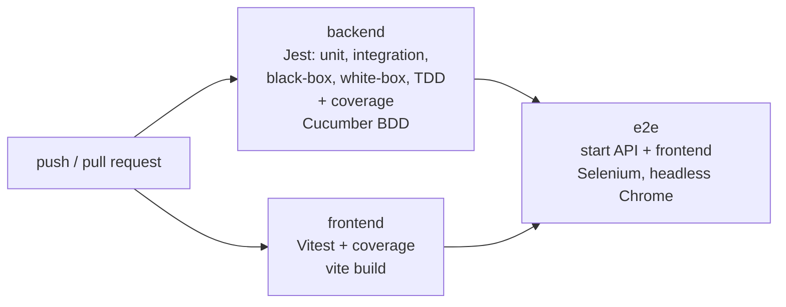
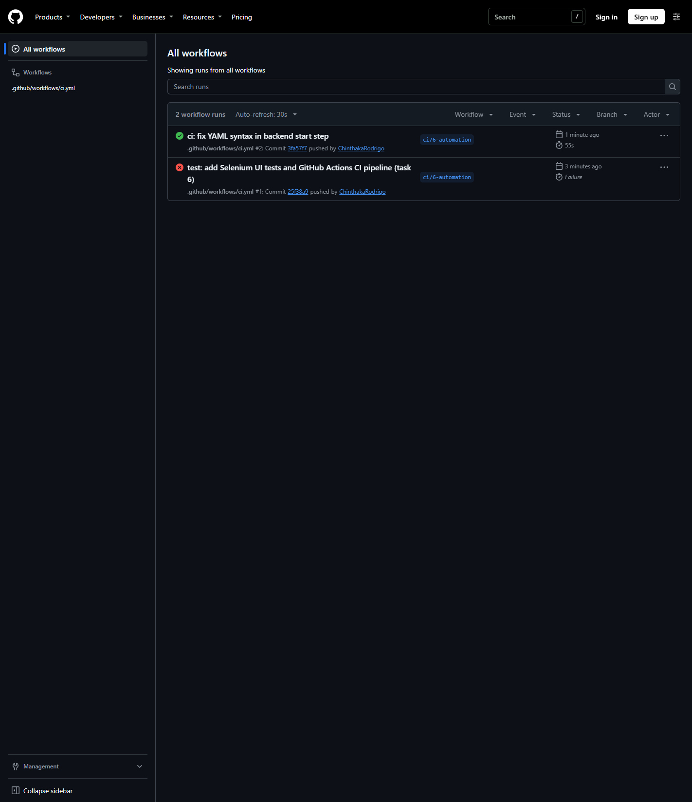
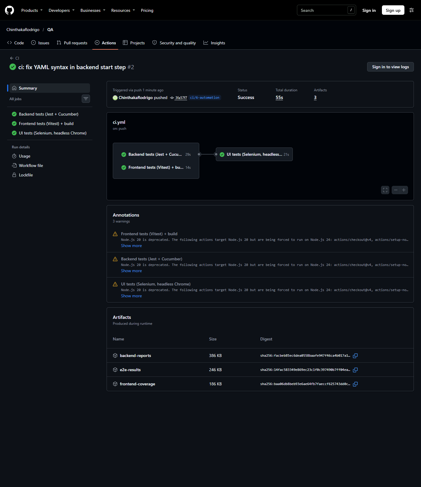

# 6. Test Automation and CI/CD

## 6.1 Approach

| Item | Details |
|---|---|
| UI automation tool | **Selenium WebDriver 4** (`selenium-webdriver` for Node.js) driving **Google Chrome**. It runs headless in CI and can show a browser window locally. |
| Test runner | Node.js built-in test runner (`node:test`), with spec output on screen and a **JUnit XML** report for CI |
| Automated test cases | 8 UI tests in `e2e/tests/`, covering README user flows 1, 3, 4, 5, 6, 9 and 15 |
| CI/CD tool | **GitHub Actions**, using `.github/workflows/ci.yml` at the repository root |
| Trigger | Every **push** (any branch), every **pull request** to `main`, and manual runs (*Run workflow* button) |
| Executed on | 2026-11-24. Locally on Windows 11, Node.js 24.15, Chrome 157. In CI on `ubuntu-latest`, Node.js 24, Chrome preinstalled. |

---

## 6.2 Selenium UI tests

### Structure

```
library-system/e2e/
├── package.json                 selenium-webdriver + npm scripts
├── support/driver.js            browser setup, login, waits, row locator, screenshots
├── tests/auth.test.js           UI-01 … UI-05
├── tests/books-and-loans.test.js UI-06 … UI-08
└── scripts/capture-pipeline.js  saves screenshots of a GitHub Actions run (evidence)
```

The tests follow a few design rules:

- **Stable locators.** The tests use element ids (`#email`), `data-testid` attributes, ARIA roles (`[role="alert"]`) and visible text. They do not use CSS layout classes.
- **Explicit waits only.** Every check waits with `until.elementLocated`, `elementTextContains` or `urlContains`, up to 10 s. There are no fixed `sleep` calls.
- **Independent tests.** Before each test, the token in `localStorage` is cleared, so every test starts as a guest. The backend is started with `DB_FILE=:memory:`, so every run begins with the same demo data. The borrow test returns the book at the end, so it leaves no data behind.
- **A screenshot after every test**, saved in `e2e/screenshots/` and uploaded as a CI artifact.

### Automated test cases

| ID | User flow | Steps | Expected result |
|---|---|---|---|
| UI-01 | Login / logout (3) | Log in as Jane, then click Logout | The nav bar shows `Hi, Jane Member (member)`. After logout, the app goes to `/login` and the greeting is gone. |
| UI-02 | Wrong password (4) | Log in with `WrongPass1` | An alert shows `Invalid email or password` and the page stays on `/login`. |
| UI-03 | Register (1) | Fill in name, a unique email and a valid password, then submit | The app goes to `/login` with `Account created. You can now log in.` |
| UI-04 | Access control, guest (15) | Open `/my-loans` while logged out | The app redirects to `/login`. |
| UI-05 | Access control, roles (15) | A member opens `/admin/users`, then an admin opens it | The member sees `Only admins can see this page.` The admin sees the **Users** page. |
| UI-06 | Browse (5) | A guest opens the Books page | 5 books are listed, with no Borrow buttons. |
| UI-07 | Search (5) | Search for `fowler` | Only *Refactoring* is listed. |
| UI-08 | Borrow and return (6, 9) | Jane borrows *Clean Code*, opens My Loans and clicks Return | The message says `You borrowed "Clean Code"`, Available goes from 3 / 3 to 2 / 3, and the loan status is `borrowed`. After Return: `"Clean Code" returned.`, status `returned`, Available is 3 / 3 again. |

### How to run locally

```bash
# Terminal 1 - backend with a fresh in-memory database
cd library-system/backend
DB_FILE=:memory: npm start        # PowerShell: $env:DB_FILE=":memory:"; npm start

# Terminal 2 - frontend
cd library-system/frontend
npm run dev

# Terminal 3 - Selenium tests
cd library-system/e2e
npm install
npm test                          # headless
HEADLESS=false npm test           # watch the browser (PowerShell: $env:HEADLESS="false"; npm test)
```

Selenium Manager, which is built into `selenium-webdriver`, downloads a matching ChromeDriver automatically. On the first run this download takes a while. Later runs take about 8 s.

### Local result

```
▶ Authentication and access control
  ✔ UI-01 member logs in, sees their name in the nav bar, then logs out
  ✔ UI-02 login with a wrong password shows an error
  ✔ UI-03 guest registers a new account and is sent to login with a success message
  ✔ UI-04 guest opening My Loans is redirected to the login page
  ✔ UI-05 member cannot open the admin Users page, but an admin can
▶ Books and loans
  ✔ UI-06 guest sees the book catalogue
  ✔ UI-07 searching for fowler shows only Refactoring
  ✔ UI-08 member borrows a book and then returns it from My Loans
ℹ tests 8
ℹ pass 8
ℹ fail 0
ℹ duration_ms 8020
```

During development the frontend server stopped in the middle of a run, and the tests that needed it failed instead of passing silently. This shows that the suite reports a broken application.

---

## 6.3 GitHub Actions pipeline

### Pipeline design



| Job | Steps | Artifacts |
|---|---|---|
| **backend** | `npm ci`, then `npm run test:coverage` (all Jest suites), then `npm run test:bdd` (Cucumber) | `backend-reports`: coverage (lcov + HTML) and the Cucumber HTML report |
| **frontend** | `npm ci`, then `npm run test:coverage` (Vitest), then `npm run build` | `frontend-coverage` |
| **e2e** | Runs only if both jobs above pass. Installs the 3 packages, starts the API (`DB_FILE=:memory:`) and Vite, waits for `/api/health`, then runs `npm run test:ci` | `e2e-results`: screenshots, `junit.xml` and server logs. A pass/fail table is also written to the run summary. |

Other settings:

- **Fast feedback.** `backend` and `frontend` run in parallel. npm downloads are cached by `actions/setup-node`.
- **Fail fast.** Any failing test makes its step exit with a non-zero code, which turns the run red. A pull request then shows a failed check.
- **No wasted runs.** A newer push to the same branch cancels a run that is still in progress (`concurrency`).
- **Artifacts are uploaded even when a run fails** (`if: always()`), so screenshots and logs are available for debugging.

### The workflow file

See [`.github/workflows/ci.yml`](../../.github/workflows/ci.yml).

---

## 6.4 Evidence: passing pipeline run

The workflow was pushed on branch `ci/6-automation`.

| Run | Commit | Result | Notes |
|---|---|---|---|
| #1 | `25f38a9` | ❌ Failure | *Invalid workflow file*: in `run: DB_FILE=:memory: nohup …`, YAML reads the `: ` (colon followed by a space) as a key/value separator. Fix: move `DB_FILE` into the step's `env:` block. |
| #2 | `3fa57f7` | ✅ Success | All 3 jobs passed: backend 29 s, frontend 14 s, Selenium UI 21 s, 55 s in total. 3 artifacts were uploaded. |

Run #2 showed a warning that the `@v4` actions run on the deprecated Node.js 20. The actions were then updated to `@v5`.

The screenshots below were taken with `scripts/capture-pipeline.js`, which opens the public run pages in headless Chrome. To make them again for any run of this public repository:

```bash
cd library-system/e2e
npm run capture:pipeline -- https://github.com/<owner>/<repo>/actions/runs/<run id>
```

| Screenshot | Shows |
|---|---|
| `images/ci-01-workflow-runs.png` | The Actions tab: the CI workflow runs with a green tick |
| `images/ci-02-run-summary.png` | One run: status *Success*, the backend → e2e and frontend → e2e job graph all green, and the 3 uploaded artifacts (`backend-reports`, `e2e-results`, `frontend-coverage`). The table of each Selenium test (job summary) is shown only to signed-in users. |




