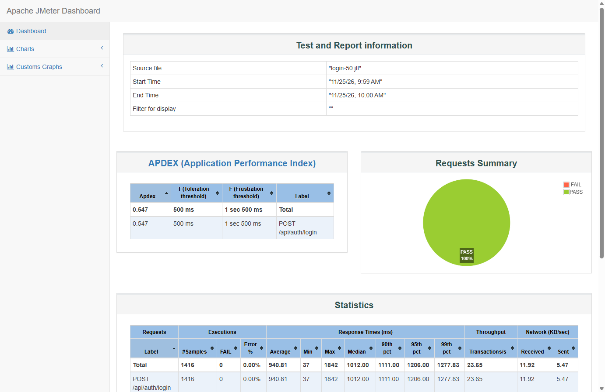
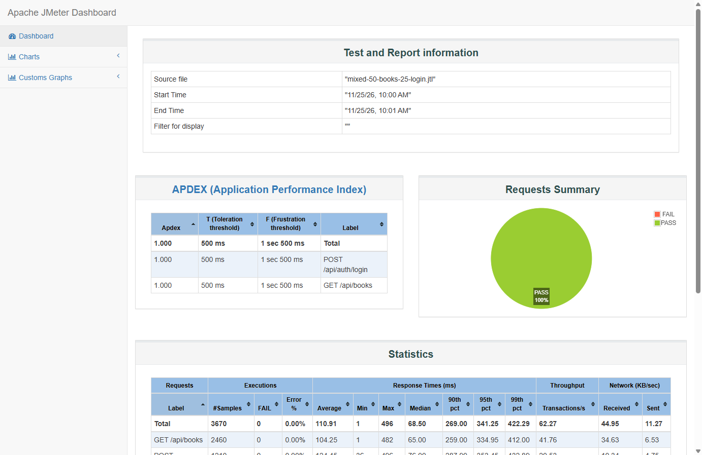
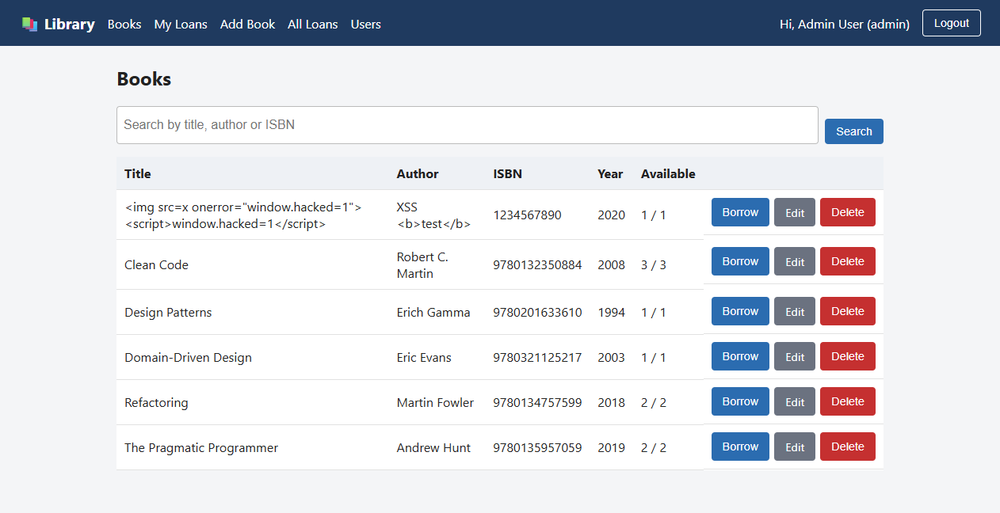
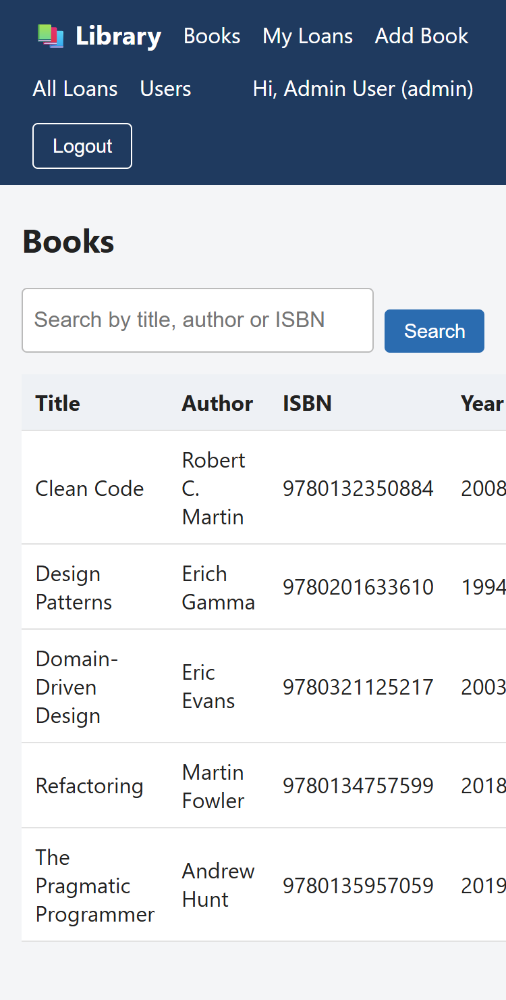
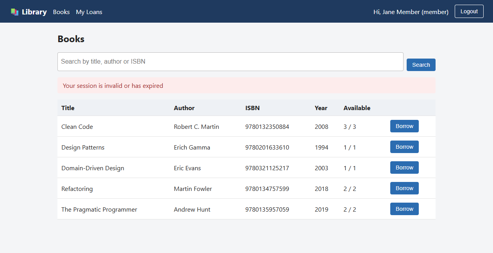
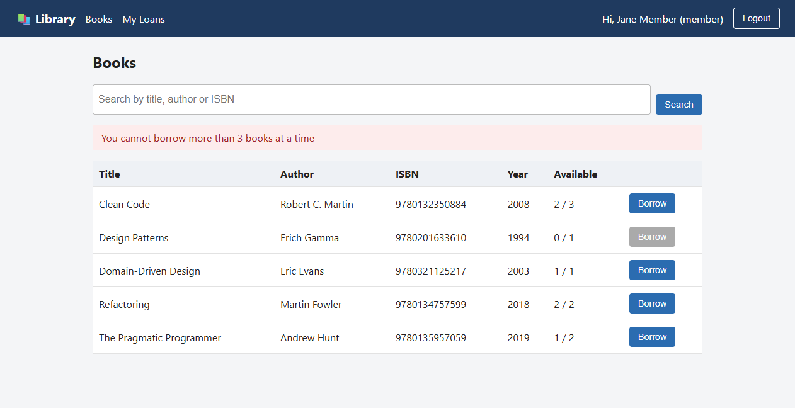
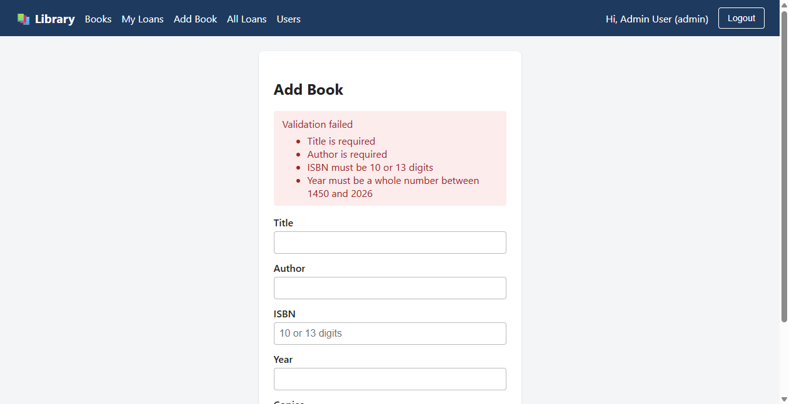

# 7. Performance, Security and Usability Testing

## 7.1 Approach

These tests check the non-functional targets of the [test plan](01-introduction-and-test-plan.md), section 1.4.

| Area | Method | Target in the test plan | Result |
|---|---|---|---|
| Performance | JMeter load tests on 2 endpoints, 8 runs of 60 s | Typical requests < 500 ms locally | Met up to 25 simultaneous login users. **Not met with 50** (PF-01) |
| Security | 24 checks in 5 OWASP Top 10 categories, plus an XSS check and `npm audit` | No unauthorised access, no critical vulnerabilities | **Not met**: admin access can be forged with the default settings (SF-01) |
| Usability | Heuristic review (Nielsen) and accessibility checks in Chrome | Main flows without help, clear error messages | Mostly met, 9 findings |

Executed on 2026-11-25.

| Item | Details |
|---|---|
| PC | Laptop, Intel Core i7-12650H (16 logical processors), 16 GB RAM, Windows 11 |
| Runtime | Node.js 24.11, Java 21 |
| Tools | Apache JMeter 5.6.3, Chrome 157 (Selenium WebDriver), Node.js script for the security checks |
| Test data | New database with the demo data (2 users, 5 books), separate from `backend/library.db` |

---

## 7.2 Performance: JMeter load test

### Design

| Item | Choice | Reason |
|---|---|---|
| Endpoint 1 | `GET /api/books` | Most used page, database read, no login needed |
| Endpoint 2 | `POST /api/auth/login` | Most expensive request: the password is hashed with scrypt |
| Users | 10, 50, 100 and 200 browsing; 10, 25 and 50 logging in; then 50 browsing + 25 logging in together | Find where the response time starts to grow |
| Ramp-up / duration | 10 s / 60 s per run | |
| Think time | 1 s between the requests of one user | A real user reads before clicking |
| Assertions | The response contains `Clean Code` / `"token"` | A fast but wrong answer counts as an error |

### How to run

1. Install [Apache JMeter 5.6.3](https://jmeter.apache.org/download_jmeter.cgi) (needs Java) and plug in the laptop charger.
2. Start the API with an empty database:
   ```powershell
   cd library-system\backend
   $env:DB_FILE = "$env:TEMP\load-test.db"; npm start
   ```
3. In a second terminal:
   ```powershell
   cd library-system
   powershell -ExecutionPolicy Bypass -File performance\run-load-tests.ps1 -JMeter C:\apache-jmeter-5.6.3\bin\jmeter.bat
   ```

To see the test in the JMeter window, open `performance/library-load-test.jmx` and press *Start* (50 users browsing). The numbers below are saved in [`performance/summary.csv`](../performance/summary.csv).

### Results

| Run | Request | Users | Samples | Errors | Average | 95th percentile | Max | Requests/s | < 500 ms? |
|---|---|---|---|---|---|---|---|---|---|
| 1 | `GET /api/books` | 10 | 545 | 0 % | 5 ms | 9 ms | 38 ms | 9.3 | Yes |
| 2 | `GET /api/books` | 50 | 2,701 | 0 % | 3 ms | 6 ms | 44 ms | 45.9 | Yes |
| 3 | `GET /api/books` | 100 | 5,399 | 0 % | 3 ms | 6 ms | 61 ms | 91.8 | Yes |
| 4 | `GET /api/books` | 200 | 10,811 | 0 % | 3 ms | 7 ms | 60 ms | 183.5 | Yes |
| 5 | `POST /api/auth/login` | 10 | 518 | 0 % | 52 ms | 75 ms | 102 ms | 8.8 | Yes |
| 6 | `POST /api/auth/login` | 25 | 1,277 | 0 % | 66 ms | 155 ms | 372 ms | 21.7 | Yes |
| 7 | `POST /api/auth/login` | 50 | 1,416 | 0 % | **941 ms** | **1,206 ms** | 1,842 ms | 23.6 | **No** |
| 8 | `GET /api/books` | 50 | 2,460 | 0 % | **104 ms** | **335 ms** | 482 ms | 41.8 | Yes |
| 8 | `POST /api/auth/login` (same run) | 25 | 1,210 | 0 % | 124 ms | 353 ms | 496 ms | 20.5 | Yes |

Run 7 (50 users logging in) and run 8 (mixed) in the JMeter dashboard:





### Analysis

- **Browsing scales well.** From 10 to 200 users the response time stays at about 3 ms and the requests per second grow with the users. The limit was not reached.
- **Login reaches its limit at about 24 requests per second.** From 25 to 50 users the throughput only rises from 21.7 to 23.6, but the average time rises from 66 to 941 ms: the extra users wait in a queue.
- **The login queue also slows everyone else.** With 50 browsing users, `GET /api/books` takes 3 ms on average (run 2), but 104 ms when 25 other users log in at the same time (run 8): about 35 times slower.

### Finding PF-01: login blocks the whole server (Medium)

**Root cause.** `utils/password.js` uses `crypto.scryptSync`. Node.js runs JavaScript on one thread, so while one password is hashed no other request is answered. A single login takes about 41 ms, so the theoretical maximum is 1000 / 41 ≈ 24 logins per second. This is the limit that was measured.

**Recommendation.** Use the asynchronous `crypto.scrypt`, which runs on a thread pool, and repeat runs 7 and 8. Do *not* make the hash weaker: a slow hash is what protects stolen passwords. Limiting login attempts (SF-02) also helps.

### Validity of the results

A first execution of the same runs was **discarded**. It gave only about 5 logins per second, and up to 11 % errors (connection reset) with 50 users. The cause was the test environment, not the application:

- The laptop was on battery and Windows slowed down the API as a background process. One login took 135–165 ms with the slow-down and about 42 ms without it, with the same code.
- JMeter wrote its results into a OneDrive folder, which was being uploaded during the test.

For the results above, Windows power throttling was switched off for the API and JMeter processes and the results were written outside OneDrive. Remaining limits: the laptop was still on battery, JMeter and the API shared one PC (no network delay), and the database was small.

---

## 7.3 Security: OWASP Top 10

Each check was designed by hand as an attack on the running API. The requests are collected in [`security/owasp-checks.js`](../security/owasp-checks.js) so they can be repeated after a fix. The script starts its own API with a temporary database. The full output is in [`security/owasp-results.txt`](../security/owasp-results.txt).

```powershell
cd library-system\backend; npm install; cd ..
node security/owasp-checks.js
```

Category numbers are from **OWASP Top 10:2021**. In the 2025 edition A02 is A04, A03 is A05 and A05 is A02; A01, A07 and A09 keep their numbers.

### Results

| ID | Category | Check | Expected | Actual | Status |
|---|---|---|---|---|---|
| SEC-01 | A01 Broken access control | Guest calls all 13 protected routes | 401 | 401 for all | Pass |
| SEC-02 | A01 | Member calls all 9 admin routes | 403 | 403 for all | Pass |
| SEC-03 | A01 | Register with an extra `"role": "admin"` field | `member` | `member` | Pass |
| SEC-04 | A01 | Return another member's loan by changing the id (IDOR) | 403 | 403, loan still open | Pass |
| SEC-05 | A01 | Use the token of a deleted user | 401 | 401 | Pass |
| SEC-06 | A02 Cryptographic failures | Read a password from the database | Salted hash | 16-byte salt + 64-byte scrypt hash | Pass |
| SEC-07 | A02 | Password hashes in API responses | None | None | Pass |
| SEC-08 | A02 | Unsigned token (`alg: none`) | 401 | 401 | Pass |
| SEC-09 | A02 | Token with the user id changed to the admin's | 401 | 401 | Pass |
| SEC-10 | A02 | Admin token signed with the default secret from the source code | 401 | **200, all users listed** | **Fail (SF-01)** |
| SEC-10b | A02 | SEC-10 again, with `JWT_SECRET` set | 401 | 401 | Pass |
| SEC-11 | A03 Injection | SQL injection in the book search (`OR`, `UNION`, `DROP TABLE`) | 0 books | 0 books | Pass |
| SEC-12 | A03 | SQL injection in the login email | 401 | 401 | Pass |
| SEC-13 | A03 | SQL injection in a URL id | 400 | 400 | Pass |
| SEC-14 | A05 Security misconfiguration | Technology shown in a header | No | **`X-Powered-By: Express`** | **Fail (SF-07)** |
| SEC-15 | A05 | Security headers | Present | **All 3 missing** | **Fail (SF-07)** |
| SEC-16 | A05 | Stack trace or file path in error responses | No | No | Pass |
| SEC-17 | A05 | Log in with the admin password from the public README | Refused | **200** | **Fail (SF-03)** |
| SEC-18 | A07 Authentication failures | 100 wrong passwords, then the right one | 429 or lock | **100 × 401 in 4.7 s, then 200** | **Fail (SF-02)** |
| SEC-19 | A09 Logging failures | Failed logins in the server log | Logged | **Log is empty** | **Fail (SF-05)** |
| SEC-20 | A07 | Same error for unknown email and wrong password | Identical | Identical | Pass |
| SEC-21 | A07 | Same response time for registered and unknown email | About equal | **44.1 ms / 1.5 ms** | **Fail (SF-06)** |
| SEC-22 | A07 | Register with the password `password1` | 400 | **201** | **Fail (SF-08)** |
| SEC-23 | A07 | Old token after an admin resets the password | 401 | **200** | **Fail (SF-04)** |

**24 checks: 15 passed, 9 failed.** Access control (A01) and injection (A03) are well protected. The weaknesses are in authentication and configuration.

Two more checks:

- **Stored XSS (A03), in the browser.** A book was added with the title `<script>…</script>`. React shows it as plain text and the code did not run: pass.
- **Vulnerable components (A06), `npm audit`.** Production packages: 0 vulnerabilities in the backend and frontend. Backend development packages: 18 moderate, all from one problem in `glob`, which Jest uses. It does not reach users; update Jest when a fix is available.



### Findings

| ID | Severity | Check | Problem | Recommendation |
|---|---|---|---|---|
| SF-01 | **Critical** | SEC-10 | `middleware/auth.js` uses `'library-dev-secret'` when `JWT_SECRET` is not set. The source code is public, and the README does not mention the setting, so anyone can become admin without a password | Stop the server at start if `JWT_SECRET` is missing (except in tests); document it in the README |
| SF-02 | **High** | SEC-18 | Unlimited login attempts, about 20 guesses per second | Limit attempts per account and IP, for example 5 per 15 minutes, then answer 429 |
| SF-03 | **High** | SEC-17 | The demo admin account is created in every new database | Create demo accounts only in development, or force a password change |
| SF-04 | Medium | SEC-23 | After a password reset, an attacker who has the old token stays logged in for up to 8 hours | Store a token version per user and increase it when the password changes |
| SF-05 | Medium | SEC-19 | Failed logins are not logged, so an attack is not noticed | Log time, IP and email of failed logins (never the password) |
| SF-06 | Low | SEC-21 | Login is about 30 times faster for unknown emails because no password is hashed. This shows which emails are registered (registration also shows this with 409) | Compare with a dummy hash when the user does not exist |
| SF-07 | Low | SEC-14, SEC-15 | Technology is revealed, security headers are missing (HSTS only matters with HTTPS) | Use the `helmet` package, which also removes `X-Powered-By` |
| SF-08 | Low | SEC-22 | Very common passwords are allowed. The README rule allows them, so this is a gap in the requirement | Reject a list of common passwords |

### Repeat the two main attacks by hand

Start the backend and frontend, open http://localhost:3000 and press **F12 → Console**.

**SEC-10, forged admin token (A02).** Create a token in a terminal. No password is needed:
```powershell
cd library-system\backend
node -p "require('jsonwebtoken').sign({ id: 1 }, 'library-dev-secret')"
```
Use it in the Console while logged out. The list of all users appears:
```js
await (await fetch('/api/users', { headers: { Authorization: 'Bearer PASTE_TOKEN_HERE' } })).json()
```

**SEC-18, brute force (A07).** No attempt is blocked: all 100 answers are 401, never 429:
```js
for (let i = 0; i < 100; i++) {
  const r = await fetch('/api/auth/login', { method: 'POST', headers: { 'Content-Type': 'application/json' },
    body: JSON.stringify({ email: 'jane@library.com', password: 'Wrong' + i }) });
  console.log(i, r.status);
}
```

---

## 7.4 Usability

### Method

The production build was used in Chrome at 1280 px and at phone width (375 px) as guest, member and admin. The pages were checked against Nielsen's 10 heuristics. This is an expert review; it does not replace a test with real users (see UAT in the test plan).

### Heuristic review

| # | Heuristic | Observation | Result |
|---|---|---|---|
| 1 | Visibility of system status | Borrow, return and delete show a message. Adding a book shows none, and "No books found." appears while books are still loading | **UX-01, UX-02** |
| 2 | Match with the real world | Clear words: Borrow, Return, Due, Fine | Pass |
| 3 | User control and freedom | Forms have Cancel. A guest who opens My Loans is sent to Books after login, not to My Loans | **UX-05** |
| 4 | Consistency and standards | Same buttons, colours and messages on every page | Pass |
| 5 | Error prevention | Delete asks for confirmation; Borrow is disabled at 0 copies, but stays enabled for a book already borrowed and after 3 loans | **UX-03** |
| 6 | Recognition rather than recall | Password rule and ISBN format are shown in the form | Pass |
| 7 | Flexibility and efficiency | Enter submits the search | Pass |
| 8 | Minimalist design | Clean pages. An old success message stays visible after a new search | **UX-06** |
| 9 | Help with errors | All errors are listed in plain language, but not next to the field, and the field is not marked | **UX-07** |
| 10 | Help and documentation | No help page; the loan rules (14 days, 3 books, fines) are not shown before borrowing | Acceptable for a small system |

### Accessibility checks

| Check | Result |
|---|---|
| Page language, viewport setting | Pass (`lang="en"`, viewport set) |
| Every input has a label | Pass (0 without a label on 5 pages) |
| Text contrast at least 4.5 : 1 (WCAG AA) | Pass on 5 admin pages (lowest: 4.83 : 1, grey buttons) |
| Keyboard | Pass on the login page: logical Tab order, visible focus |
| Errors announced to screen readers | Pass (`role="alert"`) |
| Headings and titles | **Fail**: no `h1`, the same title on every page, empty table header above the buttons (UX-08) |
| Phone width (375 px) | **Fail**: the page is 702 px wide (UX-04) |

### Findings

| ID | Severity | Problem | Recommendation |
|---|---|---|---|
| UX-01 | Low | "No books found." is shown while the list is loading | Show "Loading…" until the data arrives |
| UX-02 | Low | No message after a book is added | Show "Book added", as after borrowing |
| UX-03 | Low | Borrow is enabled although the click can only fail (already borrowed, 3-book limit) | Disable the button and show the reason |
| UX-04 | Medium | On a phone, tables are wider than the screen on Books (702 px), All Loans (660 px) and Users (546 px). The Borrow buttons are outside the screen | Put the table in a container with `overflow-x: auto`, or show cards on small screens (mobile is out of scope in the test plan) |
| UX-05 | Low | After login the user is not returned to the page they asked for | Remember the page in `ProtectedRoute` |
| UX-06 | Low | Old messages stay on screen after a new search | Clear the message when a new action starts |
| UX-07 | Low | Errors are not connected to their field (`aria-invalid`, focus) | Show each error below its field and move the focus there |
| UX-08 | Low | No `h1`, same page title everywhere, empty table header | Use `h1`, set `document.title`, add a hidden "Actions" header |
| UX-09 | Medium | When the session has expired, the error is shown but the page still says "Hi, Jane Member" and there is no link to log in | On 401, log the user out and open Login with a message |

| UX-04: Books on a phone | UX-09: expired session |
|---|---|
|  |  |

| UX-03: Borrow enabled after 3 loans | UX-07: errors above the form |
|---|---|
|  |  |

---

## 7.5 Conclusion

| Characteristic (ISO/IEC 25010) | Assessment |
|---|---|
| Performance efficiency | Good for a small library. Login is the bottleneck: about 24 per second, and it slows other requests (PF-01) |
| Security | Access control, SQL injection and XSS protection work. **Must not be deployed before SF-01, SF-02 and SF-03 are fixed** |
| Usability | Main flows are clear and errors are understandable. Fix UX-04 and UX-09 first |

The 18 findings (1 performance, 8 security, 9 usability) should be added to the [defect register](05-defect-tracking.md). Recommended order: SF-01, SF-03, SF-02, PF-01, SF-04, SF-05, UX-09, UX-04, then the rest. The status is *New*: nothing was changed in the application code during this task.
